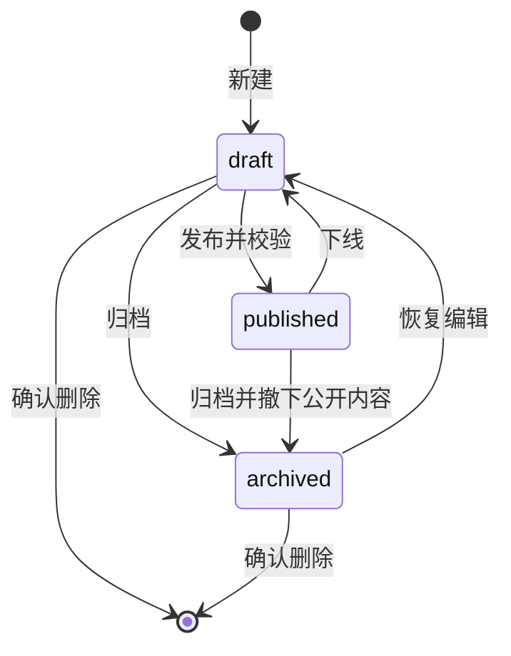

# 需求与页面设计

上级文档：[开发总览](README.md)。本文明确首期产品范围。

## 1. 使用者与目标

访客希望快速了解站主是谁、擅长什么、做过什么，并阅读技术经验和生活记录。管理员即站主，希望通过浏览器完成资料和内容更新，避免每次发布都操作 Git 或服务器。

默认全部发布内容公开；草稿仅管理员可见。首期不提供“仅链接可见”“密码文章”或读者账户，防止可见性规则过于复杂。

## 2. 页面地图

| 路径 | 页面 | 内容与主要交互 |
| --- | --- | --- |
| `/` | 首页 | 标语、简短介绍、精选作品、最近博客、最近生活、社交入口 |
| `/about` | 关于 | 头像、完整介绍、技能分组、经历时间线、公开联系方式 |
| `/posts` | 技术博客 | 分页、分类、标签、关键词搜索 |
| `/posts/:slug` | 博客详情 | 标题、摘要、发布时间、正文、目录、标签 |
| `/projects` | 作品列表 | 封面、简介、技术栈、项目阶段、精选与排序 |
| `/projects/:slug` | 作品详情 | 问题背景、实现说明、截图、技术栈、仓库/演示链接 |
| `/life` | 生活列表 | 按发生日期倒序的图文卡片和标签筛选 |
| `/life/:slug` | 生活详情 | 日期、正文、图片与自愿公开的模糊地点 |
| `/admin/login` | 登录 | 用户名、密码、错误提示 |
| `/admin` | 流量总览 | 7/30 天 PV、UV、趋势、来源、设备和热门内容 |
| `/admin/visits` | 访问明细 | 日期、来源、区域、关键词筛选与分页 |
| `/admin/access-rules` | 封锁规则 | IP/区域规则、有效期、解除与状态 |
| `/admin/experiences` | 经历时间线 | 新建、编辑、排序、删除及预览；保存至 profile 集合 |
| `/admin/profile` | 个人介绍 | 基础资料、技能、经历、社交链接 |
| `/admin/contents?kind=…` | 内容管理 | 三个分类入口，搜索、状态筛选、编辑和状态操作 |
| `/admin/contents/new?kind=…` | 创建 | 对应类型的编辑表单 |
| `/admin/contents/:id/edit` | 编辑/预览 | Markdown、媒体、分类标签、发布确认 |
| `/admin/taxonomy` | 分类与标签 | 新建、修改名称、删除未引用条目 |
| `/admin/media` | 媒体库 | 上传、预览、查看引用、删除未引用图片 |
| `/admin/settings` | 站点设置 | 站点名、描述、页脚文案与密码修改入口 |

未知公开路径展示 404。API 的 404、服务器异常、无结果和未加载状态必须分别展示，避免把接口故障伪装为空列表。

## 3. 内容字段与业务规则

三类内容共用标题、slug、摘要、Markdown 正文、封面、分类、标签、状态、精选、排序值和 SEO 字段。博客必须有正文；作品还需技术栈、项目阶段与可选外链；生活分享必须有发生日期，可包含正文和相册，至少有一种。

| 类型 | 必填字段 | 专用字段 |
| --- | --- | --- |
| `blog` | 标题、slug、摘要、正文 | 首期无额外表 |
| `project` | 标题、slug、摘要、正文、项目阶段 | `tech_stack`、`repository_url`、`demo_url`、`project_stage`、`started_on`、`ended_on`、相册 |
| `life` | 标题、slug、摘要、发生日期 | `occurred_on`、`location_label`、相册；正文与相册至少一项 |

分类为单选且可为空，标签为多选且最多 10 个。分类/标签绑定 kind，例如项目的 Rust 标签和博客的 Rust 标签各自独立。外链允许 `https://`；联系方式单独允许 `mailto:`。不对外公开住址、电话、私人邮箱等未确认内容。

## 4. 状态机与编辑语义

状态必须通过单独的状态接口修改，普通保存不能暗中发布。已发布内容的编辑保存即更新线上数据，仍需执行发布级别校验。归档内容只读，恢复草稿后才能编辑。已发布内容不可直接删除；先下线或归档，再永久删除。

首期不支持一篇文章同时保留线上版本和独立草稿。编辑页展示“保存后立即更新公开内容”，需要完整重写时引导先下线。草稿预览只在已登录后台展示，不产生可分享的公开预览 URL。

## 5. 首页面与排序

- 首页取精选作品最多 6 个、最近博客 5 篇、最近生活 4 条；公开查询始终排除草稿和归档。
- 博客按 `published_at DESC, id DESC`；首次发布记录发布时间，重新发布保留原值。
- 作品按 `sort_order ASC, published_at DESC, id DESC`；同排序值有确定顺序。
- 生活按 `occurred_on DESC, published_at DESC, id DESC`；发生日期与发布日期分别展示。
- 精选只影响首页筛选，不能让未发布内容出现在首页；不允许设置未来发布时间。

## 6. 管理体验

保存按钮显示进行中和成功/失败状态；保存失败保留编辑内容。存在未保存修改时，页面内跳转和关闭页面应提醒。首期提供手动保存，避免自动保存意外更新已发布内容。

媒体先上传到私有库，再绑定文章。预览使用同一套 Markdown 渲染组件。状态切换、永久删除和删除媒体需要明确说明影响并由管理员确认；重复点击期间禁用按钮。

## 7. 非功能要求与边界

设计覆盖 360px 手机到桌面，键盘可操作菜单、表单和弹窗；图片有替代文本，动画尊重减少动态效果的系统设置。中文为首期界面语言，技术内容可中英混写。

首期性能以单机、小规模个人内容为前提；公开列表默认每页 12 项，上限 50，后台默认 20。图片上传原件限制 10 MiB，并限制解码尺寸；不允许视频或任意附件上传。具体请求限制见接口与安全文档。

当前 UI 已包含第一方流量统计、访问明细和 IP/区域封锁，均纳入首期目标；不接入第三方统计。口径和执行边界见 [11](11-analytics-and-access-control.md)。当前主导航不提供独立下载中心；不新增软件包托管接口，作品外链继续使用 repository_url/demo_url；页脚 RSS 暂为占位，未实现前隐藏或禁用。

后续可扩展独立修订稿、SSR、内容版本历史、评论、RSS、全文搜索与对象存储。扩展前应有实际需求和验收条件，不预先拆成微服务。
