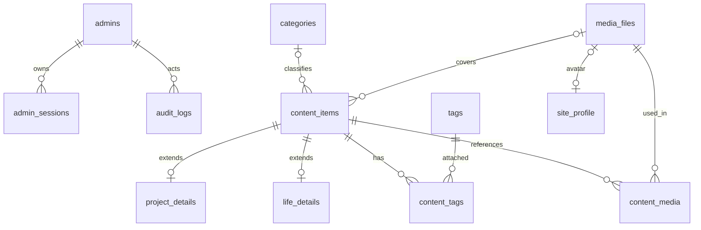

# 数据模型与保存方式

上级文档：[开发总览](README.md)。本文描述数据库设计模型，对应已实现的 [SQL 迁移](../../backend/migrations/README.md)。后续结构修改必须追加迁移，不能改写已应用版本。

## 1. 存储职责

| 数据 | 保存位置 | 说明 |
| --- | --- | --- |
| 资料、内容、分类标签、会话、审计 | PostgreSQL | 约束、事务、查询与版本控制 |
| Markdown 原文 | PostgreSQL text | 与状态、标签、媒体引用一起事务保存 |
| 上传图片与缩略图 | 私有 Docker 媒体卷 | UUID 存储键；后端鉴权读取 |
| 前端资源 | 不可变镜像 | 构建生成，不作为用户数据备份 |
| 部署秘密 | 宿主机受限文件 → 容器 secret 文件 | 不入 Git、镜像或浏览器 |
| 数据备份 | 本机暂存 + 加密异机副本 | 数据库与媒体为同一备份集 |

首期不把正文保存为仓库 Markdown 文件，不把图片二进制保存进数据库；日常编辑只调用后台 API。未来可单独开发导出工具，导出 Markdown、JSON 元数据与图片，导出功能不能替代完整数据库备份。

## 2. 实体关系



所有业务时间为 `timestamptz`，生活日期为 `date`；UUID 在应用生成。字符串长度限制同时在 API 与数据库核心字段执行。created_at/updated_at 由数据库或服务端统一维护，禁止客户端指定。

## 3. 账号、会话、资料与设置

| 表 | 字段与约束 |
| --- | --- |
| `admins` | id uuid PK；singleton_key smallint UNIQUE CHECK=1，限制单账号；username varchar(64) UNIQUE，统一小写；password_hash text（Argon2id PHC 字符串）；created_at、updated_at |
| `admin_sessions` | id uuid PK（内部 ID）；admin_id FK CASCADE；token_hash bytea UNIQUE（32 字节 SHA-256）；csrf_token text；created_at、last_seen_at、expires_at、absolute_expires_at |
| `site_profile` | id smallint PK CHECK=1；display_name varchar(80)；headline varchar(160)；intro varchar(300)；stats jsonb（experience/projects/notes 字符串）；bio_markdown text；avatar_media_id FK RESTRICT/null；location_label、public_email 可空；social_links/skill_groups/experiences jsonb；version int；updated_at |
| `site_settings` | id smallint PK CHECK=1；site_name、site_description、footer_text；default_seo_title/default_seo_description 可空；version int；updated_at |

Session Cookie 的明文随机 token 不入库，只保存摘要；CSRF token 可以作为与 Session 关联的随机值保存在库中，不能独立用于登录。expires_at 表示当前闲置到期时间，absolute_expires_at 表示创建后绝对到期，后者不能滑动延长。服务端每次检查两者，最多每 5 分钟更新 last_seen_at/闲置期限。

资料中 stats 对象、social_links/skill_groups/experiences 数组结构见 [10](10-data-transfer-objects.md)。经历按月保存 start_date/end_date 字符串，校验合法月份及顺序；不能以每月 1 日冒充真实日期。stats 是站主填写的展示文案，初始化三个值为空，不自动当成真实数据库计数。仅对整体读写、不独立筛选的小型有序集合使用 jsonb；数组列设置 `jsonb_typeof(...)=array`、stats 设置 object 检查，应用校验每项结构、长度和日期。不能把全部内容塞入一个 JSON 文档表。

bio_markdown 支持安全文本格式，不支持图片；头像通过 avatar_media_id 绑定。若未来资料正文需要插图，须先增加资料媒体引用关系，避免无法跟踪与清理的文件。

初始化迁移插入默认资料和站点设置，version=1；display_name 使用“站主”、site_name 使用“个人网站”，其他可空字段/集合为空。上线前填写真实信息；内容为空时展示简洁的空状态，不自动发布原型中的示例内容。

## 4. 内容与扩展表

`content_items` 为三类内容的共同主表：

| 字段 | 类型/规则 |
| --- | --- |
| id | uuid PK |
| kind | varchar(16)，blog/project/life，创建后不变 |
| title / slug / excerpt | varchar(120) / varchar(100) / varchar(300)，非空 |
| body_markdown | text NOT NULL，默认空字符串 |
| status | varchar(16)，draft/published/archived，默认 draft |
| cover_media_id | uuid/null，FK media_files RESTRICT |
| category_id | uuid/null，复合 FK 与 kind 绑定 |
| featured / sort_order | boolean 默认 false / integer 默认 0 |
| seo_title / seo_description | varchar(70)/varchar(160)，可空 |
| published_at | timestamptz/null，首次发布后保留 |
| created_at / updated_at | timestamptz NOT NULL |
| version | integer NOT NULL 默认 1，CHECK > 0 |

`project_details`：content_id 为 PK，kind 固定 project，复合 FK(content_id,kind) 指向主表，ON DELETE CASCADE；started_on date NOT NULL；ended_on date/null（CHECK 为空或 >= started_on）；tech_stack jsonb 字符串数组；repository_url/demo_url text 可空；project_stage 为 idea/building/maintained/completed。

`life_details`：content_id 为 PK，kind 固定 life，同样使用复合 FK；occurred_on date NOT NULL；location_label varchar(100) 可空。

主表添加 UNIQUE(id,kind) 供复合外键使用。服务层保证 project/life 有且仅有一个对应扩展记录，blog 无扩展记录，主表与扩展表在同一事务创建/更新；不能仅依赖前端 kind。

代表性约束片段（需在正式迁移中结合建表顺序补全）：

```sql
UNIQUE (kind, slug),
UNIQUE (id, kind),
CHECK (kind IN ('blog', 'project', 'life')),
CHECK (status IN ('draft', 'published', 'archived')),
CHECK (slug ~ '^[a-z0-9]+(-[a-z0-9]+)*$'),
CHECK (char_length(title) BETWEEN 1 AND 120),
CHECK (char_length(excerpt) BETWEEN 1 AND 300),
CHECK (char_length(body_markdown) <= 200000),
CHECK (version > 0),
CHECK (status <> 'published' OR published_at IS NOT NULL)
```

不使用 `CHECK(published_at <= now())` 这类依赖当前时间的约束；服务端禁止用户提交发布时间，首次发布用当前数据库时间。

## 5. 分类、标签和引用表

| 表 | 设计 |
| --- | --- |
| `categories` | id PK；kind；name varchar(50)；slug varchar(100)；sort_order int；version；created_at/updated_at；UNIQUE(kind,slug)、UNIQUE(id,kind) |
| `tags` | id PK；kind；name varchar(50)；slug varchar(100)；version；created_at/updated_at；UNIQUE(kind,slug)、UNIQUE(id,kind) |
| `content_tags` | content_id、tag_id、kind；PK(content_id,tag_id)；两个复合 FK 强制 kind 一致；内容删除 CASCADE，标签删除 RESTRICT |
| `content_media` | content_id、media_id、role（body/gallery）、position int/null、alt varchar(200)/null；PK(content_id,media_id,role)；内容删除 CASCADE、媒体删除 RESTRICT |

主表 `(category_id,kind)` 外键引用 categories(id,kind)，删除分类 RESTRICT。关联表避免只有应用校验而数据库允许博客绑定作品标签。分类/标签 kind 也使用 CHECK 限定三种值。

正文引用在每次保存时由后端使用 Markdown AST 解析 `media:UUID` 自动重建，不信任前端提交的“引用列表”。同一正文多次使用同一图片只记一条 role=body，position/alt 留空，替代文本保留在 Markdown 中。

相册由 gallery 数组生成 role=gallery，position 非负且同内容唯一，alt 为该图在当前内容中的说明。封面只保存在 cover_media_id，不重复写入 content_media；头像只保存在 site_profile。reference_count 为这些引用的合计，不持久化可漂移的计数器。

公开图片规则：ready 且被任一已发布内容的封面/正文/相册引用，或是当前公开头像。草稿、归档引用不能赋予公开权限；同一图片若仍被其他已发布内容引用则继续公开。已经公开过的信息无法从访客本地副本撤回。

## 6. 媒体表与文件布局

`media_files`：id uuid PK；storage_key text UNIQUE；thumbnail_key text UNIQUE；mime_type varchar(32)；byte_size bigint CHECK >0；width/height int CHECK >0；alt varchar(200)；sha256 bytea；state varchar(16) CHECK ready/deleting；created_at timestamptz。

hash 对保存后的文件计算，用于完整性验证；首期不按 hash 自动去重，避免不同私有内容通过去重结果互相推断。原始文件名可不保存，不能用来构造路径。

```text
/data/media/
  .tmp/<随机上传ID>
  2026/10/<媒体UUID>/original.webp
  2026/10/<媒体UUID>/thumb.webp
```

扩展名取决于实际重编码格式，storage_key 只记录相对路径。未关联媒体也保持私有，不在上传后自动开放。首期不自动删除所有“未使用图片”，只清理崩溃遗留临时文件；正常孤立媒体由后台人工删除。

## 7. 索引与查询

- 内容唯一索引 `(kind,slug)`；公开列表部分索引 `(kind,published_at DESC,id DESC) WHERE status='published'`。
- 作品公开排序部分索引 `(sort_order,published_at DESC,id DESC) WHERE kind='project' AND status='published'`。
- 后台列表 `(kind,status,updated_at DESC,id DESC)`；按具体 EXPLAIN 结果调整，不盲目添加全部组合。
- life_details `(occurred_on DESC,content_id DESC)`；公开查询与主表 JOIN 并过滤状态。
- content_tags `(tag_id,content_id)`，content_media `(media_id,content_id)`；主表 cover_media_id、category_id 及资料 avatar_media_id 添加引用查找索引。
- admin_sessions 的 token_hash 唯一索引及 expires_at 索引，audit_logs 的 created_at 索引。

首期关键词搜索仅标题/摘要 ILIKE，普通 B-tree 无法加速任意包含匹配。内容增长后评估 pg_trgm 的 GIN 索引或专用中文搜索，再更新接口与性能指标。

## 8. 审计、删除与迁移

`audit_logs`：id uuid PK；admin_id FK（账号不开放删除）；action varchar(64)；resource_type、resource_id；request_id；created_at；metadata jsonb 只保存状态转换、变更字段名等最少信息，不存密码、会话、正文或完整用户资料。失败登录进安全日志而不是伪造成功审计。

内容永久删除时级联扩展与关系，不级联图片文件；媒体被任何状态内容或头像引用时禁止删除。并发引用与删除按后端文档行锁协议执行，FK 为最后防线。媒体 deleting 状态禁止读取和新引用，可恢复重试删除文件。

SQLx migrations 顺序命名：基础表 → 内容扩展与关系 → 约束/索引 → 初始资料设置。已执行的迁移不修改，后续用新迁移演进；迁移先在生产备份副本验证。枚举使用 text/varchar + CHECK，增加状态时需要显式迁移和业务更新。

备份恢复必须成套包含数据库和媒体，详见 [部署运维](08-deployment.md)。PostgreSQL 的逻辑转储可导出数据库内容，详见 [官方 SQL Dump 文档](https://www.postgresql.org/docs/current/backup-dump.html)；文件卷需要单独保存，转储不包含图片。

## 9. 流量与规则表

同一 PostgreSQL 中另建 visit_events、analytics_daily、region_catalog、access_rules；字段、索引、保留时间及并发约束集中维护在 [11](11-analytics-and-access-control.md)。这些表不与公开内容 DTO 混用。迁移顺序追加区域目录、事件和规则表及索引；清理任务不得删除内容、媒体或未过期规则。
