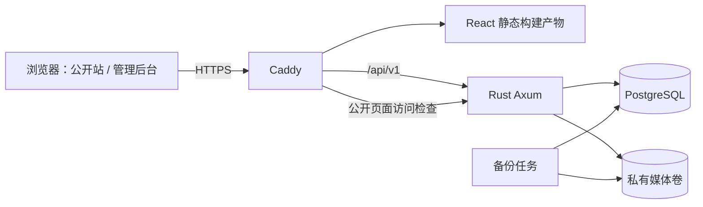

# 个人网站开发总览

更新日期：2026-10-26。定位：以当前 UI 为依据的开发设计基线；Rust 后端和数据库已实现并完成本地验收，前端接入和生产部署尚待完成。

## 1. 项目范围与实现现状

网站由公开站和单管理员后台组成。公开站展示首页、个人介绍、技术博客、作品、生活记录和联系方式；后台负责内容发布、资料维护、流量分析、访问记录及封锁规则。保持现有 UI 的信息结构，正式开发时替换示例数据和本地保存逻辑。

| 代码位置 | 当前已确认情况 | 正式开发目标 |
| --- | --- | --- |
| `docs/pages/index.html`、`contact.js` | 原生 HTML/CSS/JS，公开站分区、筛选、弹窗 | React 组件与真实 API 数据 |
| `docs/pages/article.html`、`article-data.js` | 三类详情；读取内置示例数据 | 按 kind/slug 查询已发布内容 |
| `docs/pages/login.html`、`login.js` | 仅表单交互，凭据未传输，没有真实登录 | 服务端 Session 登录 |
| `docs/pages/admin*.js` | 内容/资料/封锁规则在当前浏览器 localStorage 保存；统计由脚本生成 | 数据统一保存到后端，跨设备读取，服务端执行权限和规则 |
| `docs/pages/contact-data.js` | 公开联系方式配置 | 由个人资料 API 提供 |
| `frontend/` | React/Vite 入口、完整页面路由及公开站/后台第一版已实现；类型检查与生产构建通过，真实 API 闭环尚待联调 | 按 [前端框架规划](13-frontend-framework.md) 完成可运行工程 |
| `backend/` | Axum/Tokio/SQLx 后端、17 张业务表、鉴权、内容/媒体/统计/封锁及 CLI 已实现；详见 [后端说明](../../backend/README.md) | 前端联调、代理部署及恢复演练 |

静态原型中的“保存”“发布”“封锁”仍是演示；后端已有对应真实 API，但未完成前端联调和生产部署。原型示例经历、项目、浏览量不作为站主真实数据自动导入。

## 2. 总体架构

采用前后端独立工程、同域名部署、一个 Rust 服务和一个 PostgreSQL 数据库。首期不拆微服务、不引入 Redis。

| 层 | 职责与技术路线 |
| --- | --- |
| 前端 | React/TypeScript/Vite；公开和后台分别布局；React Router 导航、TanStack Query 管理请求缓存；Markdown 编辑与预览 |
| 后端 | Axum/Tokio；路由 → 业务服务 → repository；会话鉴权、字段校验、发布状态、并发版本、访问控制均由 Rust 执行 |
| 数据 | SQLx/PostgreSQL 保存业务数据、Markdown、Session、统计和规则；图片文件保存在媒体卷 |
| 部署 | Docker Compose/Caddy；HTTPS、静态资源、同源代理；数据库及后端端口只在内部网络开放 |

开发时前端通过 Vite 代理请求 Rust；生产通过 Caddy。浏览器不能直连数据库。上述均为既有技术路线的设计约定，依赖版本在工程初始化时验证并锁定。首期公开站采用 SPA，爬虫和分享卡片限制见 [02](02-architecture.md)。

## 3. 前后端接口边界

统一业务前缀 `/api/v1`，普通数据采用 UTF-8 JSON、snake_case 字段；图片上传用 multipart，读取返回图片二进制。HTTP 路径与语义见 [05 接口契约](05-api-contract.md)，完整传输对象见 [10 数据结构](10-data-transfer-objects.md)。

| 功能 | 代表接口 | 权限与数据流 |
| --- | --- | --- |
| 公开资料和内容 | `GET /profile`、`/posts`、`/projects`、`/life` | 只返回公开资料与 published 内容 |
| 登录 | `POST /auth/login`、`GET /auth/session` | HttpOnly Cookie；前端不保存登录令牌 |
| 内容管理 | `/admin/contents`、`/{id}/status` | Session；写入检查 Origin、CSRF、version |
| 资料、经历和设置 | `/admin/profile`、`/admin/settings` | 完整对象保存，version 防止覆盖；经历是 profile 的有序集合 |
| 图片 | `/admin/media`、`/media/{id}` | 先上传私有图片，再绑定内容；公开读取检查已发布引用 |
| 流量与访问记录 | `/analytics/pageviews`、`/admin/analytics`、`/admin/visits` | 访客仅上报页面事件；统计及 IP 明细仅管理员读取 |
| 访问控制 | `/admin/access-rules`、`/admin/regions` | 规则入库，由服务端匹配 IP/区域并拦截，前端负责操作反馈 |

例如“发布博客”：后台上传图片 → 得到媒体 UUID → 保存 Markdown 草稿及引用 → 得到内容 ID/version → 单独提交发布 → 后端事务更新状态 → 公开 API 返回文章。此过程不需要重新构建前端。已发布内容保存会立即更新公开版本；首期无独立修订稿。

## 4. 数据保存与传输原则

| 数据 | 保存方式 | 传输方式 |
| --- | --- | --- |
| 博客、作品、生活 | 内容主表 + 类型扩展 + 分类/标签关系 | 写入使用关联 UUID；读取使用展示摘要；kind 统一 blog/project/life |
| 个人介绍、技能、经历 | 单例资料行；小型有序集合用 jsonb | profile JSON；经历按月，项目/生活按日 |
| 正文 | PostgreSQL text 中保存 Markdown 原文 | `body_markdown`；图片引用 `media:UUID`，前端受控渲染 |
| 图片 | 文件卷存图片/缩略图；数据库存元数据和引用 | multipart 上传；响应为媒体 ID、URL、尺寸等，不返回磁盘路径 |
| 管理员、会话 | 密码散列、会话 token 摘要保存在数据库 | 安全 Cookie + 内存中的 CSRF token |
| 流量及访问规则 | 访问事件、聚合表、封锁规则表 | 后端生成 IP/归属地；管理接口读取统计及规则 |

统一 UUID 标识、UTC RFC 3339 时间、正整数 version。null 表示清空可空值，[] 表示清空集合；完整 PUT 不允许省略字段。公开 DTO 不包含密码、会话、内部存储键或管理版本。localStorage 不是正式业务数据存储，原型字段适配见 [12](12-ui-integration.md)。

数据库和媒体使用独立持久卷，并成套加密备份到异机位置。容器替换保留数据；备份需经过实际恢复验证。详细约束见 [06](06-data-storage.md)，统计口径和访问控制见 [11](11-analytics-and-access-control.md)。

## 5. 文档结构与阅读顺序

本文只说明范围、边界和核心数据流，细节按主题维护：

| 文档 | 内容 |
| --- | --- |
| [01 需求与页面](01-requirements-and-pages.md) | 页面地图、首期范围、内容状态与业务行为 |
| [02 系统架构](02-architecture.md) | 工程目录、模块职责、请求链路、技术取舍 |
| [03 前端](03-frontend.md) | 路由、组件、请求状态、表单及 Markdown |
| [04 后端](04-backend.md) | Rust 分层、中间件、事务、上传与错误处理 |
| [05 接口契约](05-api-contract.md) | HTTP 方法/路径、请求限制、返回值、错误码 |
| [06 数据存储](06-data-storage.md) | 表结构、约束、索引、文件布局与迁移 |
| [07 后台与安全](07-admin-and-security.md) | 会话、CSRF、后台操作、安全边界 |
| [08 部署运维](08-deployment.md) | 代理、配置、持久化、备份恢复 |
| [09 实施验收](09-implementation-and-testing.md) | 开发顺序、测试场景、完成标准 |
| [10 传输数据结构](10-data-transfer-objects.md) | TypeScript DTO、读写差异、JSON 示例 |
| [11 流量与访问控制](11-analytics-and-access-control.md) | 统计口径、事件与规则接口、存储、拦截链路 |
| [12 UI 对接](12-ui-integration.md) | 原型与正式路由映射、字段迁移、逐页接口依赖 |
| [13 前端框架规划](13-frontend-framework.md) | app/layouts/pages/shared/assets 目录职责、路由、数据流与实施阶段 |

阅读顺序建议：总览 → 02 → 05/10 → 06 → 自己负责的专题。05 负责 HTTP 契约，10 负责共享 DTO，06 负责持久化约束，11 补充统计和规则领域；修改字段时同步更新这些文档，实施阶段再生成 OpenAPI 和数据库迁移。

## 6. 开发顺序与交付边界

先搭建工程和数据库，再完成“登录 → 修改个人介绍 → 公开读取”，随后完成三类内容和媒体闭环、公开 UI 对接、统计和真实访问控制，最后部署及恢复演练。逐项验收见 [09](09-implementation-and-testing.md)。

当前已有后端实现与前端第一版代码；具体状态分别见后端实现记录与前端框架规划，前端完整联调和生产部署仍待验收。正式上线前需补充真实内容、域名、运行环境、归属地数据源及备份位置，并记录实际测试结果。

